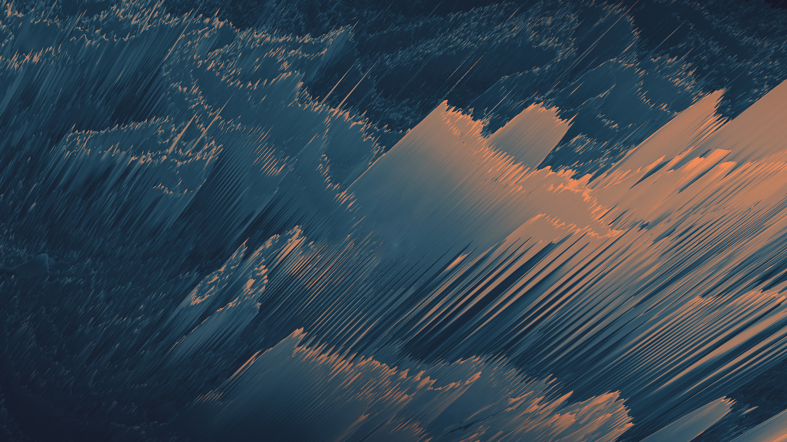
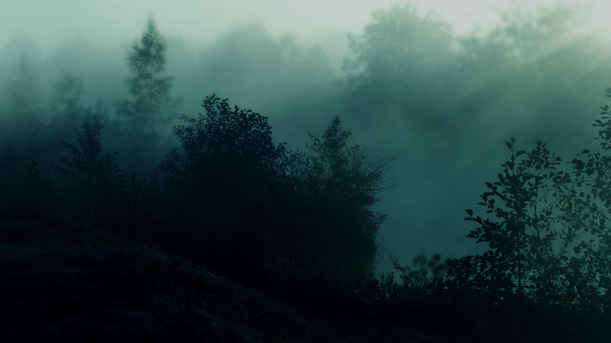
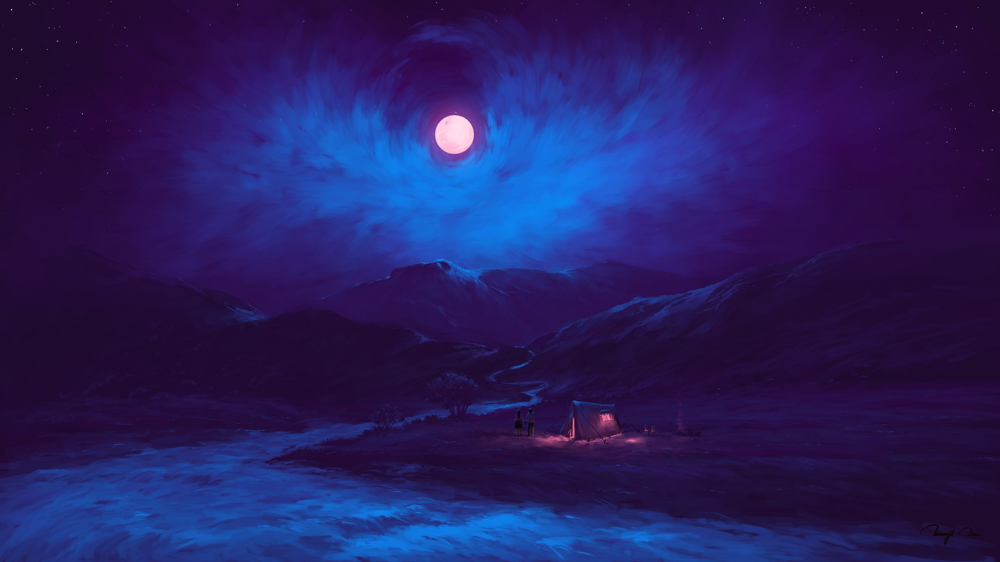
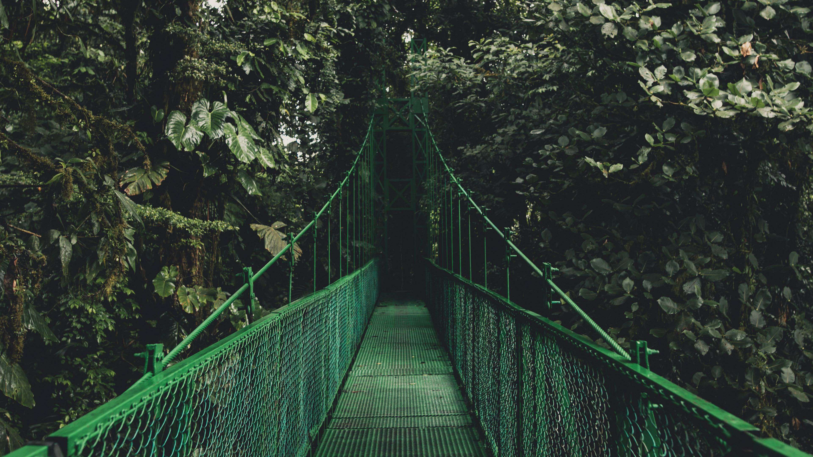
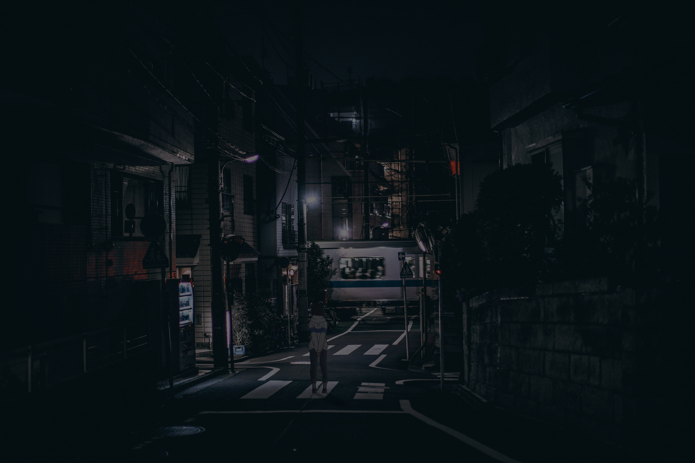
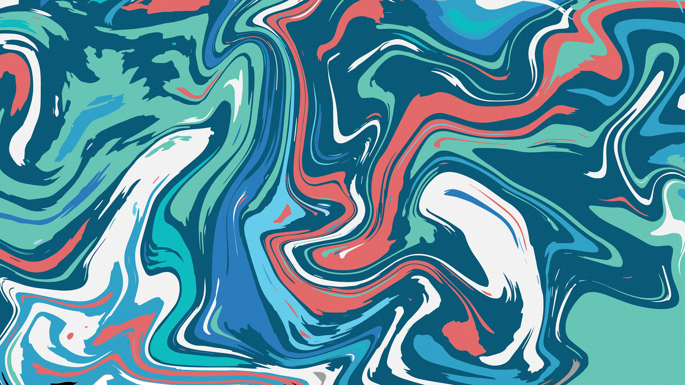
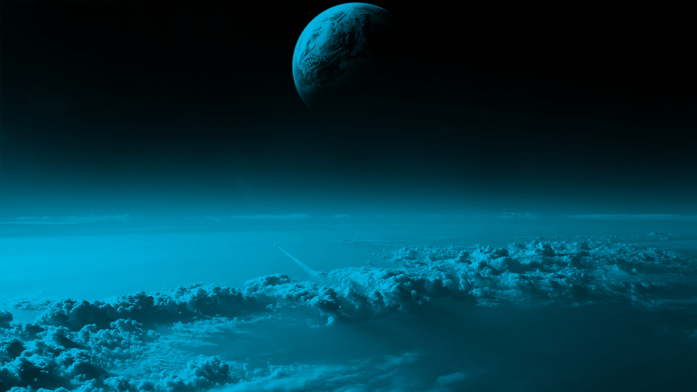

# Wallpapers I Like

This is my personal list of wallpapers I think look cool.

It is mainly a place where I collect desktop backgrounds I like, so I can find them again and use them across my devices. The repo includes JPG, PNG, GIF, and WebP wallpapers, with a mix of landscapes, city scenes, abstract images, character art, and animated backgrounds.

## Preview

| | | |
| --- | --- | --- |
|  |  |  |
|  |  |  |
|  |  |  |

## About

- Personal wallpaper list
- Static and animated backgrounds
- Mostly desktop-friendly 16:9 images
- Formats: JPG, JPEG, PNG, GIF, WebP

## Download

Download the full collection from GitHub:

```sh
git clone https://github.com/tobayashi-san/wallpapers.git
```

Or use **Code -> Download ZIP** on the repository page.

To update an existing local copy:

```sh
git pull
```

## Usage

Browse the repository and download individual files directly from GitHub, or clone the full collection if you want everything locally.

On Linux desktop environments, most files can be set as a wallpaper directly from the file manager or system settings. Animated GIF support depends on the desktop environment or wallpaper tool.

## Note

This is just a personal collection of wallpapers I like. No blanket license is declared for reuse, redistribution, or commercial use.
